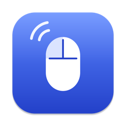
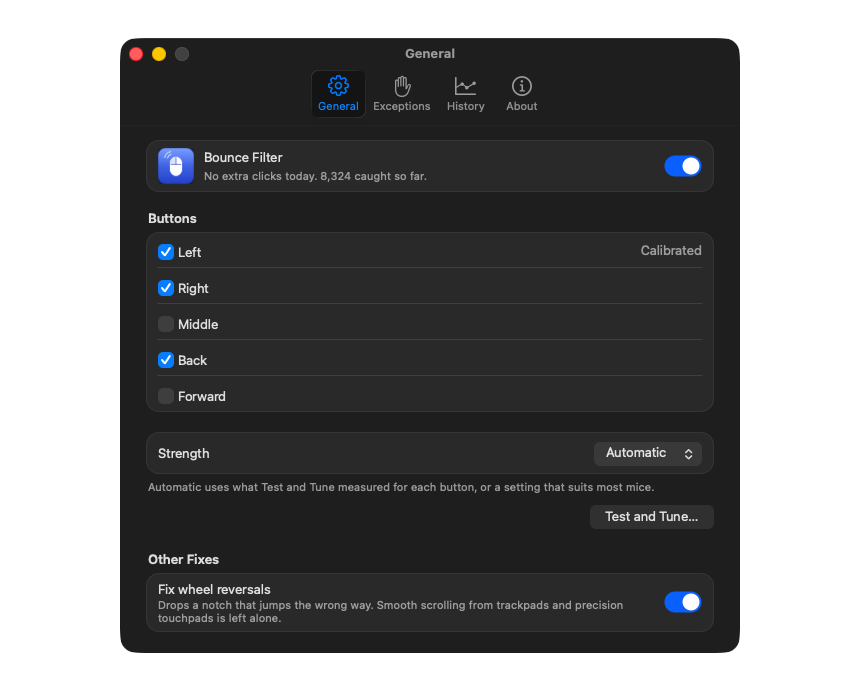
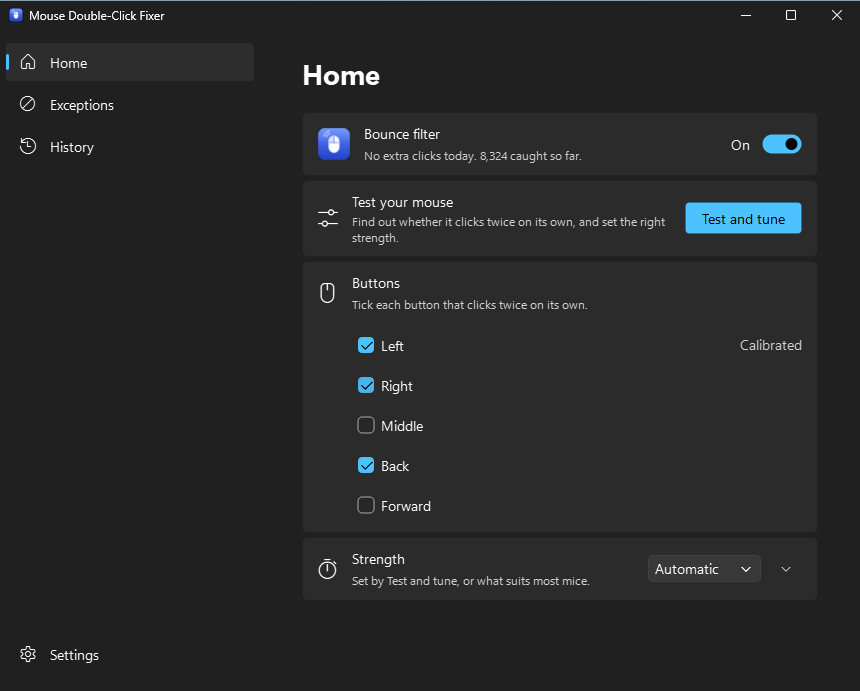

<div align="center">



# Mouse Double-Click Fixer

**Fix a mouse that double-clicks when you click once.**<br>
A free, open-source app for Windows and macOS that stops mouse double-clicking caused by a worn switch. It filters the extra clicks (switch bounce, or "chatter") and leaves your real double-clicks alone.

[](https://github.com/arnav-goel10/mouse-double-click-fixer/releases/latest)
[](https://github.com/arnav-goel10/mouse-double-click-fixer/actions/workflows/ci.yml)
[%20%7C%20Windows%2010%2F11%20(x64)-lightgrey)](#download)
[](LICENSE)

**[Download for Mac](https://github.com/arnav-goel10/mouse-double-click-fixer/releases/latest/download/DoubleClickFixer.dmg)** &nbsp;·&nbsp;
**[Download for Windows](https://github.com/arnav-goel10/mouse-double-click-fixer/releases/latest/download/DoubleClickFixer-Setup.exe)** &nbsp;·&nbsp;
[All releases](https://github.com/arnav-goel10/mouse-double-click-fixer/releases)

</div>

<p align="center">
  
  
</p>
<p align="center"><sub>macOS &nbsp;·&nbsp; Windows 11</sub></p>

## How it is built and tested

Python and Qt for Python (PySide6). The filter sits in each system's own input path, an event tap on macOS and a low-level mouse hook on Windows. [CI](https://github.com/arnav-goel10/mouse-double-click-fixer/actions/workflows/ci.yml) ([`ci.yml`](.github/workflows/ci.yml)) runs on every pull request and every push to `main`:

- **Unit tests** on Windows and macOS, on each Python from 3.11 to 3.14 (the `test` job).
- **macOS event tap end-to-end** (`macos-tap`): GitHub's Macs let a job create a real event tap, so clicks are posted through the real filter in the real event stream ([`tests/test_macos_tap_e2e.py`](tests/test_macos_tap_e2e.py)).
- **Windows hook end-to-end** (`windows-hook`): clicks are injected through the real low-level hook ([`tests/test_windows_hook.py`](tests/test_windows_hook.py)). Both end-to-end jobs also press the real pause shortcut and check it arrives with no keyboard hook.
- **Windows install, quit and update end-to-end** (`windows-install`): builds the installer, installs it over running copies of two older releases, installs an update signed for that run, refuses an unsigned one, and uninstalls ([`tools/windows_install_e2e.ps1`](tools/windows_install_e2e.ps1)).
- **Signed updates:** each release's `SHA256SUMS.txt` is signed in minisign format on the maintainer's computer, and the app checks that signature in pure Python before it installs anything ([`app/update_signature.py`](app/update_signature.py)).
- **Pinned builds:** every Python package is installed with `--require-hashes` from [`requirements-build.txt`](requirements-build.txt), and every action is pinned to a commit. [`release.yml`](.github/workflows/release.yml) builds from the tag, runs all of CI first, and only ever puts up a draft.

## The problem

Mouse buttons wear out. The metal contact inside starts to bounce, so a single click arrives twice. If your mouse does any of these, this is the app for it:

- it **double-clicks when you click once**: files open when you meant to select them, links open in two tabs;
- **drag and drop lets go** halfway, or text selection keeps restarting;
- a **held button seems to release on its own** while you drag a window or a file.

It happens to every brand sooner or later: Logitech, Razer, SteelSeries, Microsoft and others. Replacing the switch fixes it for good. If your mouse's own software has a debounce setting, try raising that first. Otherwise Mouse Double-Click Fixer fixes it in software, on Windows 10, Windows 11 and macOS.

## How it works

A bounce has a tell-tale signature: the extra press arrives a few milliseconds after the button was released, far faster than a finger can lift and press again. A deliberate double-click leaves the button up for much longer.

- **Clicks.** A press that comes within the filter window of the last release is dropped, along with its release, so apps never see half a click. The window is 46 ms until Test and Tune measures your mouse, and each button has its own.
- **Drags.** A worn switch can also lose contact for an instant while you hold it, which would end a drag. So every release of the left, right and middle buttons is held back until the filter window has passed. If the contact comes straight back, both are dropped and the drag simply continues; otherwise the release is delivered, where you let go of the button. Holding releases back has a cost, described under [Does it delay my clicks?](docs/FAQ.md#does-it-delay-my-clicks).
- **Clicks followed by a quick move.** When you click in place and move away, the release goes out as the pointer leaves the spot, before the movement reaches apps, so the click lands where you made it.
- **Back and forward buttons** can be filtered too, and are off until you turn them on. They use the click rule only: a press inside the window of the last release is dropped. Their releases are never held back for the window, and a drag made with one isn't protected.
- **The scroll wheel** has a fix for a worn encoder that now and then reports one notch the wrong way in the middle of a scroll. With it on, a notch that goes the opposite way to the one before it and arrives within the wheel window (50 ms by default) is dropped. No notch is held back for the window. Smooth scrolling is never touched: a Mac trackpad's, a Magic Mouse's, and on Windows a precision touchpad's. It is off until you turn it on.
- **Trackpads, touchscreens and pens** are not filtered: the app tells them apart from mice and passes their clicks through. On Windows that means precision touchpads, with the exceptions under [Known limitations](#known-limitations). You can also pick any mouse to leave alone, and any app to leave alone while it is in front.
- **On Windows**, while the pointer is hidden (as it is in most games' mouse-look), the app never holds back or re-sends pointer movement. While it is hidden, and in a remote session, a held release isn't sent when the pointer moves: it goes out once the filter window has passed, with your next click or by a timer, wherever the pointer is then.
- **Test and Tune protects your double-clicks.** It measures your own double-click speed and recommends a filter window of no more than half of it.

The filter sits in the system's own input path, an event tap on macOS and a low-level mouse hook on Windows, so every app sees the filtered clicks. On macOS clicks are timed by the events' own timestamps. On Windows they are timed by when the filter sees them, less any delay that Windows' 16 ms clock shows, so a busy computer hardly distorts the gaps (a delay under 16 ms can't be seen). A held release is settled by the events that follow it: once one from after the filter window arrives, no press can still be on its way to cancel it. With nothing after it, as when you click and keep the mouse still, a timer settles it after the window plus an allowance for how late this computer delivers mouse events. On macOS, clicks and pointer movement come through one event tap, so a move that takes the pointer off the spot of a click can't reach apps ahead of that click's release. All of it happens on your computer.

## Features

- **System-wide filtering** for the left, right and middle buttons, and for back and forward if you want them. Each button is optional and has its own window.
- **Drag protection** for the left, right and middle buttons, from the moment the button goes down.
- **Strength: Automatic or Custom.** Automatic uses what Test and Tune measured for each button, or 46 ms where it hasn't measured one. Custom lets you set each button's window yourself, in milliseconds.
- **Test and Tune**, one short task: click a pad, see in plain words whether the button double-clicks on its own, choose a window (a recommended one is offered), try it on a second pad, and apply it.
- **A plain status line.** The main window and the Windows tray flyout say what the filter has done today, for example "Your left button bounced 14 times today. Every bounce was caught.", or "No extra clicks seen yet." The macOS menu bar menu shows the running total of bounces blocked.
- **Pause for 15 minutes** from the menu bar menu (macOS) or the notification area menu (Windows), or with a shortcut: ⌃⌥⌘P on macOS, Ctrl+Alt+Shift+P on Windows. Filtering comes back by itself, or when you choose **Resume**.
- **Pause during full-screen games**, if you turn it on (it is off by default): filtering stops while a full-screen game is in front and starts again when it isn't. How it tells a game is in the [FAQ](docs/FAQ.md#can-it-stand-aside-while-i-play-a-game), with its limits.
- **A health check** in History: whether your mouse is bouncing, whether it is getting worse, and, when bounces creep up toward a button's window, a suggested longer window that you can apply with one click. Nothing changes until you choose it.
- **Notes about other mouse utilities** (Logi Options+, Logitech Options, G HUB, Razer Synapse, Mac Mouse Fix, SteerMouse, LinearMouse, BetterMouse, X-Mouse Button Control and DoubleClickFix) that are running and may take over buttons or the wheel.
- **Scroll-wheel fix** for a wheel that now and then jumps one notch the wrong way. Off by default.
- **Exceptions:** *Apps*, where nothing is filtered while a listed app is in front (the active app counts, not the window under the pointer); *Games*, the pause above; and *Devices*, the mice the app has seen, each of which you can leave unfiltered. Trackpads, touchscreens and pens are listed separately, with no switch.
- **History** of your last 30 days: bounces per 100 clicks for each button, a trend ("Getting worse", "About the same", "Getting better"), and how long after a release each bounce came. It stays on your computer.
- **Native on both platforms:** on macOS a menu bar menu, and a Settings window with a toolbar of panes (General, Exceptions, History, About); on Windows 11 a notification area icon with a flyout and a menu, and a window with navigation on the left (Home, Exceptions, History, Settings). Light and dark mode follow the system. Controls are exposed to screen readers such as VoiceOver and Narrator, and keyboard focus is shown.
- **Runs quietly:** lives in the menu bar or notification area, opens at login if you want, and on macOS has no Dock icon while its window is closed, unless you hide its menu bar icon.
- **Signed automatic updates** from this repository's releases. Each release's checksums are signed on the maintainer's computer, with a key that never goes to GitHub or CI, and the app installs nothing that fails the check. Checking and installing can each be turned off. The signature covers updates only: the apps are not signed with an Apple or Microsoft developer certificate, as the next section explains.
- **Copy Diagnostics** puts the version, the filter's state and the app's recent log on the clipboard for a bug report.

## Download

| Platform | Get it | Notes |
| --- | --- | --- |
| **macOS 13 or later** (Apple silicon) | [DoubleClickFixer.dmg](https://github.com/arnav-goel10/mouse-double-click-fixer/releases/latest/download/DoubleClickFixer.dmg) | Open it and drag Mouse Double-Click Fixer onto Applications. |
| **Windows 10** (version 1809 or later) **or 11**, 64-bit | [DoubleClickFixer-Setup.exe](https://github.com/arnav-goel10/mouse-double-click-fixer/releases/latest/download/DoubleClickFixer-Setup.exe) | Or the [portable exe](https://github.com/arnav-goel10/mouse-double-click-fixer/releases/latest/download/DoubleClickFixer.exe), no installation needed. |

The apps are not yet signed with an Apple or Microsoft developer certificate, so the first launch takes an extra step:

- **macOS 15 and later:** open the app; macOS says it can't verify it. Choose **Done**, go to **System Settings › Privacy & Security**, scroll to the message about Mouse Double-Click Fixer, choose **Open Anyway** (it is there for about an hour after you tried) and confirm with your password. On macOS 13 and 14, Control-click the app in Applications and choose **Open** instead.
- **Permission on macOS:** the first window explains it. Choose **Continue**, then allow Mouse Double-Click Fixer when macOS asks, under **Privacy & Security › Device Control and Data Access** (**Accessibility** on macOS 26 and earlier). macOS only lets apps you approve filter input. The window moves on by itself once you have allowed it.
- **Windows:** if SmartScreen appears, choose **More info › Run anyway**. If Smart App Control blocks the app, Windows offers no way to run it anyway; see [Installation](docs/INSTALLATION.md#smart-app-control).

Full instructions, including uninstalling: [docs/INSTALLATION.md](docs/INSTALLATION.md).

## Getting started

1. Open Mouse Double-Click Fixer. On macOS, allow it when asked (see above); it then says **Bounce Filter is on**. On Windows the window opens on **Home**.
2. Choose **Test and Tune…**: on macOS from the mouse icon in the menu bar, or on **General**; on Windows with **Test and tune** on **Home**. It tests the left button unless you pick another at the top.
3. Click the pad once at a time until it has counted twelve clicks, then double-click five times at your usual speed. It tells you whether the button double-clicks on its own.
4. Choose **Continue**, then **Apply**. Applying sets that button's window and starts filtering that button. Repeat for any other button that bounces. If the filter is still off, the last step has a **Turn On** button (**Turn on** on Windows).

Close the window and the app keeps filtering from the menu bar or notification area. More detail in [docs/GETTING_STARTED.md](docs/GETTING_STARTED.md), and help in [docs/TROUBLESHOOTING.md](docs/TROUBLESHOOTING.md).

## FAQ

Answers to the questions people ask are in [docs/FAQ.md](docs/FAQ.md): whether it blocks real double-clicks, whether it delays clicks, drags, the macOS permission, games and anti-cheat, Automatic and Custom, pausing, whether the pause shortcut reads the keyboard, and the note about other mouse utilities.

## Privacy

No telemetry, no analytics, no accounts. The app reads mouse events, and from the keyboard only its pause shortcut, which the system reports without a keyboard hook. It keeps daily bounce counts on your computer and no record of individual clicks. Its only network use is the update check to this repository's GitHub releases, which can be turned off. The full list of what it reads, keeps and logs is in [docs/PRIVACY.md](docs/PRIVACY.md).

## Known limitations

- Back and forward buttons are filtered by the click rule only, so a drag made with one isn't protected. Buttons beyond those two aren't filtered.
- On Windows, a touchpad tap within about a second of using a mouse is filtered as that mouse's click: its release is held for the filter window, and a second tap that follows within the window is dropped as bounce.
- On Windows, only precision touchpads are told apart from mice. Any other touchpad reports to Windows as a mouse, so its clicks are filtered and its scrolling can be judged by the wheel fix like a mouse's. If **Copy Diagnostics** shows `device lookup: raw input unavailable`, the app can't tell any touchpad from a mouse: every touchpad click is filtered and the wheel fix does nothing. Touchscreens and pens still pass.
- The scroll-wheel fix can't tell a stray notch from a deliberate reversal made within the wheel window, so a reversal that quick loses the notches that arrive inside it.
- Other mouse utilities that remap the back and forward buttons or smooth the scroll wheel (Mac Mouse Fix, for example) take those events over, so the side-button and wheel fixes may have nothing to act on. The app names the ones it knows when they are running (see the [FAQ](docs/FAQ.md#it-says-another-app-may-be-changing-clicks-what-does-that-mean)), but only those. Turn those features off in the other utility if you want this app to handle them.
- The check for a full-screen game can miss a game or take another full-screen program for one; see the [FAQ](docs/FAQ.md#can-it-stand-aside-while-i-play-a-game) for what it looks at on each system.
- The pause shortcut is one fixed key combination: it can be turned off, not changed. A pause is not saved across a restart.
- The app is in English only.
- Some games' anti-cheat systems can object to software input, or to programs that hook input; turn the filter off before playing them. On Windows, games that read raw input receive the clicks the app re-sends as injected input, not as coming from your mouse.
- On Windows, over windows of apps running as administrator, drag protection is off, because Windows doesn't let an ordinary app send input to them, and bounce may not be filtered either; that is untested. See [Troubleshooting](docs/TROUBLESHOOTING.md#windows-apps-running-as-administrator).
- The apps aren't signed with an Apple or Microsoft developer certificate. On macOS that means the app isn't notarized: the copy you drag into Applications belongs to your account, so other software running as you could change it, and a changed copy would keep the app's permission. That stays possible until the app is notarized.

## Documentation

- [Installation](docs/INSTALLATION.md), including uninstalling
- [Getting started](docs/GETTING_STARTED.md)
- [Troubleshooting](docs/TROUBLESHOOTING.md)
- [FAQ](docs/FAQ.md)
- [Privacy](docs/PRIVACY.md): what the app reads, keeps and logs
- [Security](SECURITY.md): what the app can see, and how updates are verified
- [Changelog](CHANGELOG.md)
- [Releasing](docs/RELEASING.md), for maintainers

## Build from source

Python 3.11 or newer.

```bash
git clone https://github.com/arnav-goel10/mouse-double-click-fixer
cd mouse-double-click-fixer
python3 -m venv .venv && source .venv/bin/activate   # Windows: .\.venv\Scripts\Activate.ps1
pip install -r requirements.txt
python run.py
```

Run the tests with `python -m unittest discover -s tests`. Packaging and releases are covered in [docs/RELEASING.md](docs/RELEASING.md).

## Contributing

Bug reports and pull requests are welcome; start with [CONTRIBUTING.md](CONTRIBUTING.md). Please report security issues privately as described in [SECURITY.md](SECURITY.md).

## License

[MIT](LICENSE) © 2026 Arnav Goel

The apps are built on Qt and Qt for Python (LGPL-3.0), Python and other open-source software; their licences are in [THIRD_PARTY_NOTICES.md](THIRD_PARTY_NOTICES.md), and each build carries its own copy (**About › Acknowledgements…** on macOS, **Settings › About › Acknowledgements…** on Windows).
