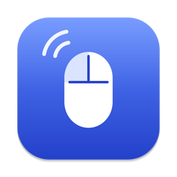
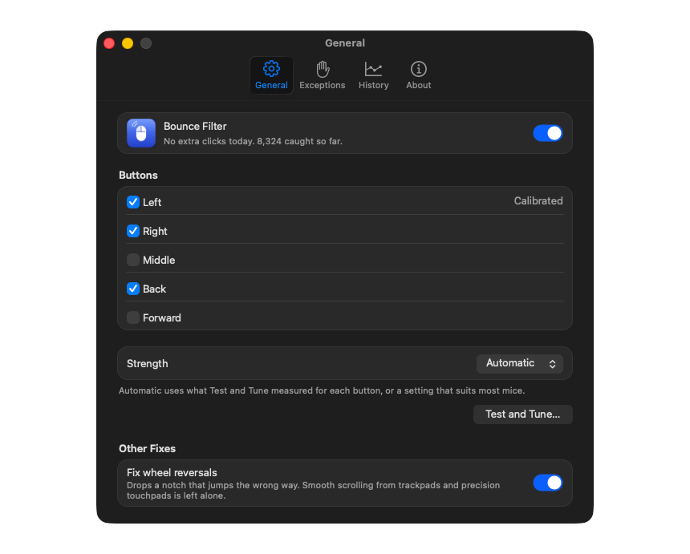
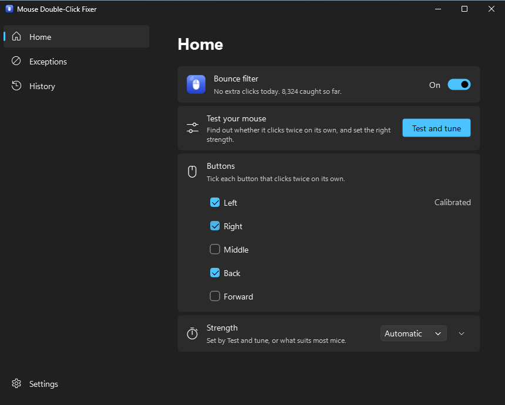

<div align="center">



# Mouse Double-Click Fixer

**Fix a mouse that double-clicks when you click once.**<br>
A free, open-source app for Windows and macOS that stops mouse double-clicking caused by a worn switch. It filters the extra clicks (switch bounce, or "chatter") and leaves your real double-clicks alone.

[](https://github.com/arnav-goel10/mouse-double-click-fixer/releases/latest)
[](https://github.com/arnav-goel10/mouse-double-click-fixer/releases)
[](https://github.com/arnav-goel10/mouse-double-click-fixer/actions/workflows/ci.yml)
[%20%7C%20Windows%2010%2F11%20(x64)-lightgrey)](#download)
[](LICENSE)

**[Download for Mac](https://github.com/arnav-goel10/mouse-double-click-fixer/releases/latest/download/DoubleClickFixer.dmg)** &nbsp;·&nbsp;
**[Download for Windows](https://github.com/arnav-goel10/mouse-double-click-fixer/releases/latest/download/DoubleClickFixer-Setup.exe)** &nbsp;·&nbsp;
[All releases](https://github.com/arnav-goel10/mouse-double-click-fixer/releases)

</div>

<p align="center">
  
  
</p>
<p align="center"><sub>macOS &nbsp;·&nbsp; Windows 11</sub></p>

## The problem

Mouse buttons wear out. The metal contact inside starts to bounce, so a single click arrives twice. If your mouse does any of these, this is the app for it:

- it **double-clicks when you click once**: files open when you meant to select them, links open in two tabs;
- **drag and drop lets go** halfway, or text selection keeps restarting;
- a **held button seems to release on its own** while you drag a window or a file.

It happens to every brand sooner or later: Logitech, Razer, SteelSeries, Microsoft and others. Replacing the switch fixes it for good. If your mouse's own software has a debounce setting, try raising that first. Otherwise Mouse Double-Click Fixer fixes it in software, on Windows 10, Windows 11 and macOS.

## How it works

A bounce has a tell-tale signature: the extra press arrives a few milliseconds after the button was released, far faster than a finger can lift and press again. A deliberate double-click leaves the button up for much longer.

- **Clicks.** A press that comes within the filter window of the last release is dropped, along with its release, so apps never see half a click. The window is 46 ms until Test and Tune measures your mouse, and each button has its own.
- **Drags.** A worn switch can also lose contact for an instant while you hold it, which would end a drag. So every release of the left, right and middle buttons is held back until the filter window has passed. If the contact comes straight back, both are dropped and the drag simply continues; otherwise the release is delivered, where you let go of the button. Holding releases back has a cost, described under [Does it delay my clicks?](#faq).
- **Clicks followed by a quick move.** When you click in place and move away, the release goes out as the pointer leaves the spot, before the movement reaches apps, so the click lands where you made it.
- **Back and forward buttons** can be filtered too, and are off until you turn them on. They use the click rule only: a press inside the window of the last release is dropped. Their releases are never held back for the window, and a drag made with one isn't protected.
- **The scroll wheel** has a fix for a worn encoder that now and then reports one notch the wrong way in the middle of a scroll. With it on, a notch that goes the opposite way to the one before it and arrives within the wheel window (50 ms by default) is dropped. No notch is held back for the window. Smooth scrolling is never touched: a Mac trackpad's, a Magic Mouse's, and on Windows a precision touchpad's. It is off until you turn it on.
- **Trackpads, touchscreens and pens** are not filtered: the app tells them apart from mice and passes their clicks through. On Windows that means precision touchpads, with the exceptions under [Known limitations](#known-limitations). You can also pick any mouse to leave alone, and any app to leave alone while it is in front.
- **On Windows**, while the pointer is hidden (as it is in most games' mouse-look), the app never holds back or re-sends pointer movement. While it is hidden, and in a remote session, a held release isn't sent when the pointer moves: it goes out once the filter window has passed, with your next click or by a timer, wherever the pointer is then.
- **Test and Tune protects your double-clicks.** It measures your own double-click speed and keeps the filter window at no more than half of it.

The filter sits in the system's own input path, an event tap on macOS and a low-level mouse hook on Windows, so every app sees the filtered clicks. On macOS clicks are timed by the events' own timestamps. On Windows they are timed by when the filter sees them, less any delay that Windows' 16 ms clock shows, so a busy computer hardly distorts the gaps (a delay under 16 ms can't be seen). A held release is settled by the events that follow it: once one from after the filter window arrives, no press can still be on its way to cancel it. With nothing after it, as when you click and keep the mouse still, a timer settles it after the window plus an allowance for how late this computer delivers mouse events. On macOS, clicks and pointer movement come through one event tap, so a move that takes the pointer off the spot of a click can't reach apps ahead of that click's release. All of it happens on your computer.

## Features

- **System-wide filtering** for the left, right and middle buttons, and for back and forward if you want them. Each button is optional and has its own window.
- **Drag protection** for the left, right and middle buttons, from the moment the button goes down.
- **Strength: Automatic or Custom.** Automatic uses what Test and Tune measured for each button, or 46 ms where it hasn't measured one. Custom lets you set each button's window yourself, in milliseconds.
- **Test and Tune**, one short task: click a pad, see in plain words whether the button double-clicks on its own, choose a window (a recommended one is offered), try it on a second pad, and apply it.
- **A plain status line.** The menu bar menu, the tray flyout and the main window say what the filter has done today, for example "Your left button bounced 14 times today. Every bounce was caught.", or "No extra clicks seen yet."
- **Pause for 15 minutes** from the menu bar menu (macOS) or the notification area menu (Windows), or with a shortcut: ⌃⌥⌘P on macOS, Ctrl+Alt+Shift+P on Windows. Filtering comes back by itself, or when you choose **Resume**.
- **Pause during full-screen games**, if you turn it on (it is off by default): filtering stops while a full-screen game is in front and starts again when it isn't. How it tells a game is in the [FAQ](#faq), with its limits.
- **A health check** in History: whether your mouse is bouncing, whether it is getting worse, and, when bounces creep up toward a button's window, a suggested longer window that you can apply with one click. Nothing changes until you choose it.
- **Notes about other mouse utilities** (Logi Options+, G HUB, Razer Synapse, Mac Mouse Fix, SteerMouse, LinearMouse, BetterMouse, X-Mouse Button Control and DoubleClickFix) that are running and may take over buttons or the wheel.
- **Scroll-wheel fix** for a wheel that now and then jumps one notch the wrong way. Off by default.
- **Exceptions:** *Apps*, where nothing is filtered while a listed app is in front (the active app counts, not the window under the pointer); *Games*, the pause above; and *Devices*, the mice the app has seen, each of which you can leave unfiltered. Trackpads, touchscreens and pens are listed separately, with no switch.
- **History** of your last 30 days: bounces per 100 clicks for each button, a trend ("Getting worse", "About the same", "Getting better"), and how long after a release each bounce came. It stays on your computer.
- **Native on both platforms:** on macOS a menu bar menu, and a Settings window with a toolbar of panes (General, Exceptions, History, About); on Windows 11 a notification area icon with a flyout and a menu, and a window with navigation on the left (Home, Exceptions, History, Settings). Light and dark mode follow the system. Controls are exposed to screen readers such as VoiceOver and Narrator, and keyboard focus is shown.
- **Runs quietly:** lives in the menu bar or notification area, opens at login if you want, and on macOS has no Dock icon while its window is closed.
- **Signed automatic updates** from this repository's releases. Each release's checksums are signed on the maintainer's computer, with a key that never goes to GitHub or CI, and the app installs nothing that fails the check. Checking and installing can each be turned off. The signature covers updates only: the apps are not signed with an Apple or Microsoft developer certificate, as the next section explains.
- **Copy Diagnostics** puts the version, the filter's state and the app's recent log on the clipboard for a bug report.

## Download

| Platform | Get it | Notes |
| --- | --- | --- |
| **macOS 13 or later** (Apple silicon) | [DoubleClickFixer.dmg](https://github.com/arnav-goel10/mouse-double-click-fixer/releases/latest/download/DoubleClickFixer.dmg) | Open it and drag Mouse Double-Click Fixer onto Applications. |
| **Windows 10** (version 1809 or later) **or 11**, 64-bit | [DoubleClickFixer-Setup.exe](https://github.com/arnav-goel10/mouse-double-click-fixer/releases/latest/download/DoubleClickFixer-Setup.exe) | Or the [portable exe](https://github.com/arnav-goel10/mouse-double-click-fixer/releases/latest/download/DoubleClickFixer.exe), no installation needed. |

The apps are not yet signed with an Apple or Microsoft developer certificate, so the first launch takes an extra step:

- **macOS 15 and later:** open the app; macOS says it can't verify it. Choose **Done**, go to **System Settings › Privacy & Security**, scroll to the message about Mouse Double-Click Fixer, choose **Open Anyway** (it is there for about an hour after you tried) and confirm with your password. On macOS 13 and 14, Control-click the app in Applications and choose **Open** instead.
- **Permission on macOS:** the first window explains it. Choose **Continue**, then allow Mouse Double-Click Fixer when macOS asks, under **Privacy & Security › Device Control and Data Access** (**Accessibility** on macOS 26 and earlier). macOS only lets apps you approve filter input. The window moves on by itself once you have allowed it.
- **Windows:** if SmartScreen appears, choose **More info › Run anyway**. If Smart App Control blocks the app, Windows offers no way to run it anyway; see [Installation](docs/INSTALLATION.md#smart-app-control).

Full instructions, including uninstalling: [docs/INSTALLATION.md](docs/INSTALLATION.md).

## Getting started

1. Open Mouse Double-Click Fixer. On macOS, allow it when asked (see above); it then says **Bounce Filter is on**. On Windows the window opens on **Home**.
2. Choose **Test and Tune…**: on macOS from the mouse icon in the menu bar, or on **General**; on Windows with **Test and tune** on **Home**. It tests the left button unless you pick another at the top.
3. Click the pad once at a time until it has counted twelve clicks, then double-click five times at your usual speed. It tells you whether the button double-clicks on its own.
4. Choose **Continue**, then **Apply**. Applying sets that button's window and starts filtering that button. Repeat for any other button that bounces. If **Bounce Filter** is still off, the last step has a **Turn On** button.

Close the window and the app keeps filtering from the menu bar or notification area. More detail in [docs/GETTING_STARTED.md](docs/GETTING_STARTED.md), and help in [docs/TROUBLESHOOTING.md](docs/TROUBLESHOOTING.md).

## FAQ

<details>
<summary><b>Will it block my real double-clicks?</b></summary>

Not once Test and Tune has measured that button. Only a press within the filter window of the previous release is dropped, and Test and Tune keeps that window at no more than half of your fastest measured double-click. Until then, the default 46 ms window can catch a very fast double-click, one that leaves the button up for less than 46 ms. A window you set yourself under **Strength › Custom** has no such limit, and a longer one can drop real double-clicks.
</details>

<details>
<summary><b>Does it delay my clicks?</b></summary>

Yes, the release of a click. Presses go straight through. The only press that waits is one that comes while a release is still on its way to apps: it goes out right after that release, usually within a millisecond or two, so apps see the two in order.

Every release of the left, right and middle buttons is held back for the filter window (46 ms until Test and Tune measures that button), so a contact dropout can't end a drag. If you move the mouse or click again, the release goes out as soon as an event from after the window arrives. On a still mouse it waits a little longer: the window plus an allowance for how late your computer delivers mouse events, which the app measures as it runs and keeps between 5 and 150 ms. On a quiet computer that is the window plus about 5 ms, for example 35 ms with a 30 ms window and 65 ms with a 60 ms window. On a busy computer the allowance grows with the delay, up to 150 ms. A click made in place is released sooner, as soon as you move the pointer off it. A shorter window means a quicker release, and so does turning the filter off for the buttons that don't bounce.

Scroll-wheel notches are never held back. Back and forward releases and clicks that pass untouched aren't held for the filter window, but like a press they can wait, usually a millisecond or two, behind a release the app is re-sending. On Windows, while the pointer is hidden or in a remote session, moving doesn't release a held click: it goes out with your next click or by the timer, where the pointer is then.
</details>

<details>
<summary><b>Are drags protected from the start?</b></summary>

Yes, for the left, right and middle buttons. Every release is held, so a dropout is caught however soon after the press it comes, as long as the contact comes back within the filter window. A dropout longer than the window still ends the drag.
</details>

<details>
<summary><b>Why does it need permission on macOS?</b></summary>

Blocking a click before other apps see it requires an event tap, and macOS only allows that for apps you have approved, under **Privacy & Security › Device Control and Data Access** (**Accessibility** on macOS 26 and earlier). The app asks only for mouse events, never keystrokes. Its pause shortcut needs no permission: see [Privacy](#privacy).
</details>

<details>
<summary><b>Will it get me flagged in games?</b></summary>

The app doesn't add clicks of its own, but it does re-send some input: a release it held back for the filter window, and whatever comes while that release is on its way to apps (a press, another button's click, and on macOS pointer movement), so that apps see them in the order they happened. On Windows the app sends no pointer movement at all, only presses and releases: it puts the pointer where your hand has taken it, and after a drag let go while moving on the spot where the button came up and back, by placing it directly, which isn't input and which no input hook sees. Apps receive re-sent input as software input (on Windows, marked as injected), and the app's hook is in the input path whenever the filter is on. Some anti-cheat systems object to one or the other, and the app can't know what yours accepts.

If a game uses anti-cheat, turn the filter off, or quit the app, before you play it. Adding the game under **Exceptions › Apps** stops all filtering while it is in front and holds nothing new back, but the app's hook stays installed, so it doesn't make that safe.

**Pause during full-screen games** (below) stops the filter while a game is in front, so nothing is held back or re-sent then. The app is still running, though, with its pause shortcut registered and a check every two seconds for a game, so it isn't a promise that a game's anti-cheat accepts it either.
</details>

<details>
<summary><b>What are Automatic and Custom?</b></summary>

They are the two ways the app picks each button's filter window, under **Strength** (on **General** on macOS, on **Home** on Windows).

**Automatic** uses the window Test and Tune measured for that button, or one you applied from a History suggestion, and 46 ms for a button it hasn't measured. **Custom** shows a window for each filtered button, in milliseconds, for you to set (and one for the scroll wheel while its fix is on). Each keeps its own windows, so switching back finds them as you left them. If you updated from 1.0 and a button you filter has a window you set by hand, you start in Custom; otherwise in Automatic. Either way every window you had is kept.
</details>

<details>
<summary><b>How do I pause it?</b></summary>

Choose **Pause for 15 Minutes** from the menu bar menu (macOS; also in the Dock menu), or **Pause for 15 minutes** from the notification area icon's right-click menu (Windows), or press the shortcut: ⌃⌥⌘P on macOS, Ctrl+Alt+Shift+P on Windows. While paused the menu says **Resume**, and so does the shortcut's next press. The status line says "Paused until 3:45 PM". When the time is up the filter starts again by itself.

Pause means something only while the filter is on. Turning the filter off ends a pause. A pause isn't saved: if you quit the app or restart the computer during one, the filter is back on when the app next starts (if it was on before). The shortcut can be turned off under **General › Pause shortcut** on macOS, **Settings › Pausing** on Windows. If another program already holds the same keys, the shortcut isn't available; **Copy Diagnostics** says so.
</details>

<details>
<summary><b>Does the pause shortcut read my keyboard?</b></summary>

No. The app doesn't listen to the keyboard. It asks the system to tell it when one key combination is pressed, using `RegisterEventHotKey` on macOS and `RegisterHotKey` on Windows, and the system says nothing else about the keyboard. No keyboard event tap or hook is installed, and macOS needs no Input Monitoring permission for it. A test in the repository checks that nothing in the app uses a keyboard hook or tap. On macOS the key is the one where the P key is on a US keyboard, so on another layout the key in that place is the one that works; on Windows it is the P key of your layout.
</details>

<details>
<summary><b>Can it stand aside while I play a game?</b></summary>

Yes, if you turn on **Exceptions › Games › Pause during full-screen games**. It is off by default. While it is on, the app asks every two seconds whether a full-screen game is in front. If one is, the filter stops, the status line says "Paused while … is in front", with the game's name where there is one, and it starts again when the game leaves the front. Choose **Resume** (or press the shortcut) to filter in that game anyway; the app then won't pause for that game again until it has left the front.

What counts as a game:

- **macOS:** the app in front says in its own bundle that it is a game (a Games category, or a request for Game Mode), and one of its windows covers a whole display. The app doesn't check whether macOS's Game Mode is actually on, as macOS gives no way to ask.
- **Windows:** a full-screen exclusive Direct3D app, or the window in front covers its whole monitor and either Windows says a full-screen app is running or the program is one on the list of games that Windows keeps for Game Bar. Browsers, video players, slide shows, meetings, remote desktop and virtual machine windows, and Windows' own screens never count.

Limits: a game on macOS whose bundle declares neither, or whose full-screen window belongs to another process (some launchers), isn't seen. On Windows, a game in a browser isn't seen, and another full-screen program that isn't a game may be taken for one. If it guesses wrong, choose **Resume**.
</details>

<details>
<summary><b>It says another app may be changing clicks. What does that mean?</b></summary>

Some mouse utilities also change what the side buttons, the middle button or the wheel do, or filter clicks themselves. The app looks every minute, and when you bring it forward, at the names of the running programs for these: Logi Options+, Logitech Options, Logitech G HUB and Razer Synapse (macOS and Windows); Mac Mouse Fix, SteerMouse, LinearMouse and BetterMouse (macOS); X-Mouse Button Control and DoubleClickFix (Windows). If one is running, **General** (**Home** on Windows), the Test and Tune verdict and **History** say which, and what it may take over. "May" is the point: the note says what that utility can be set to do, not what it does on your computer. The app changes nothing in it. If side buttons or the wheel act up, check that utility's settings, or turn off its features for those.
</details>

## Privacy

- The app receives mouse button events and pointer movement, and nothing from the keyboard except its pause shortcut: the system tells it when ⌃⌥⌘P (Ctrl+Alt+Shift+P on Windows) is pressed, and no other key reaches it. That works through `RegisterEventHotKey` on macOS and `RegisterHotKey` on Windows; no keyboard hook or event tap is installed, and macOS asks for no Input Monitoring permission for it. It also receives scroll-wheel events: on macOS only while the scroll-wheel fix is on, and on Windows always, though it looks at them only while the fix is on. It uses which button went up or down, when, and where the pointer was, and keeps no record of individual clicks.
- What it does keep is a running total of the bounces it blocked and, for the History pane, daily counts: for each button the presses, bounces and repaired dropouts, how long after a release each bounce came, and the filter window in use; and for the scroll wheel the notches the wheel fix judged and the reversals it dropped. That is in `wear.json` beside the settings, for up to a year, and holds no times or places of clicks. On macOS a second small file, `window.json`, remembers which Settings pane you last had open.
- To tell your devices apart it reads each pointing device's name, vendor and product IDs and serial number from the system, and on Windows it takes Raw Input reports from mice, touchpads and touchscreens to learn which device a click or wheel notch came from. It notes only which device sent each report, when, and for a mouse which buttons or wheel the report names, never a position. Only the devices you choose to leave unfiltered are saved, in the settings.
- To apply the Apps list it reads which app is in front, and the list of running apps when you open the add menu. It saves only the apps you add.
- To name other mouse utilities that may take over your buttons or wheel, it reads the names of the running programs (on macOS their bundle identifiers and process names, on Windows their executable names) once a minute and when you bring it forward, and nothing else about them. To pause during full-screen games, if you turn that on, it checks every two seconds whether the app in front is a game that covers the screen. On macOS that reads the front app's category in its own bundle, and the size of its windows, never their titles or contents. On Windows it reads the size of the front window, the path of its program, and the list of games Windows keeps in the registry (`HKEY_CURRENT_USER\System\GameConfigStore\Children`), which it reads again at most once a minute. None of this is saved.
- No telemetry, no analytics, no accounts.
- Its only network use is the update check to this repository's GitHub releases, and downloading an update from there. Turn off **Check for updates automatically** (**About › Software Update** on macOS, **Settings › Updates** on Windows) and it makes no request unless you ask it to check.
- Its log records start-up, the filter starting and stopping, pauses, whether the pause shortcut registered, the other mouse utilities it found, permission changes, waking from sleep and switching users, the TLS library in use, failures and updates, never clicks. It stays on your computer unless you paste it into a bug report. Copy Diagnostics also lists the pointing devices the app has seen, by name.

## Known limitations

- Back and forward buttons are filtered by the click rule only, so a drag made with one isn't protected. Buttons beyond those two aren't filtered.
- On Windows, a touchpad tap within about a second of using a mouse is filtered as that mouse's click: its release is held for the filter window, and a second tap that follows within the window is dropped as bounce.
- On Windows, only precision touchpads are told apart from mice. Any other touchpad reports to Windows as a mouse, so its clicks are filtered and its scrolling can be judged by the wheel fix like a mouse's. If **Copy Diagnostics** shows `device lookup: raw input unavailable`, the app can't tell any touchpad from a mouse: every touchpad click is filtered and the wheel fix does nothing. Touchscreens and pens still pass.
- The scroll-wheel fix can't tell a stray notch from a deliberate reversal made within the wheel window, so a reversal that quick loses the notches that arrive inside it.
- Other mouse utilities that remap the back and forward buttons or smooth the scroll wheel (Mac Mouse Fix, for example) take those events over, so the side-button and wheel fixes may have nothing to act on. The app names the ones it knows when they are running (see the [FAQ](#faq)), but only those. Turn those features off in the other utility if you want this app to handle them.
- The check for a full-screen game can miss a game or take another full-screen program for one; see the [FAQ](#faq) for what it looks at on each system.
- The pause shortcut is one fixed key combination: it can be turned off, not changed. A pause is not saved across a restart.
- The app is in English only.
- Some games' anti-cheat systems can object to software input, or to programs that hook input; turn the filter off before playing them. On Windows, games that read raw input receive the clicks the app re-sends as injected input, not as coming from your mouse.
- On Windows, over windows of apps running as administrator, drag protection is off, because Windows doesn't let an ordinary app send input to them, and bounce may not be filtered either; that is untested. See [Troubleshooting](docs/TROUBLESHOOTING.md#windows-apps-running-as-administrator).
- The apps aren't signed with an Apple or Microsoft developer certificate. On macOS that means the app isn't notarized: the copy you drag into Applications belongs to your account, so other software running as you could change it, and a changed copy would keep the app's permission. That stays possible until the app is notarized.

## Documentation

- [Installation](docs/INSTALLATION.md), including uninstalling
- [Getting started](docs/GETTING_STARTED.md)
- [Troubleshooting](docs/TROUBLESHOOTING.md)
- [Security](SECURITY.md): what the app can see, and how updates are verified
- [Changelog](CHANGELOG.md)
- [Releasing](docs/RELEASING.md), for maintainers

## Build from source

Python 3.11 or newer.

```bash
git clone https://github.com/arnav-goel10/mouse-double-click-fixer
cd mouse-double-click-fixer
python3 -m venv .venv && source .venv/bin/activate   # Windows: .\.venv\Scripts\Activate.ps1
pip install -r requirements.txt
python run.py
```

Run the tests with `python -m unittest discover -s tests`. Packaging and releases are covered in [docs/RELEASING.md](docs/RELEASING.md).

## Contributing

Bug reports and pull requests are welcome; start with [CONTRIBUTING.md](CONTRIBUTING.md). Please report security issues privately as described in [SECURITY.md](SECURITY.md).

## Support the project

Mouse Double-Click Fixer is free. If it saved you from buying a new mouse, star the repository.

## Star history

[](https://star-history.com/#arnav-goel10/mouse-double-click-fixer&Date)

## License

[MIT](LICENSE) © 2026 Arnav Goel

The apps are built on Qt and Qt for Python (LGPL-3.0), Python and other open-source software; their licences are in [THIRD_PARTY_NOTICES.md](THIRD_PARTY_NOTICES.md), and each build carries its own copy (**About › Acknowledgements…** on macOS, **Settings › About › Acknowledgements…** on Windows).
